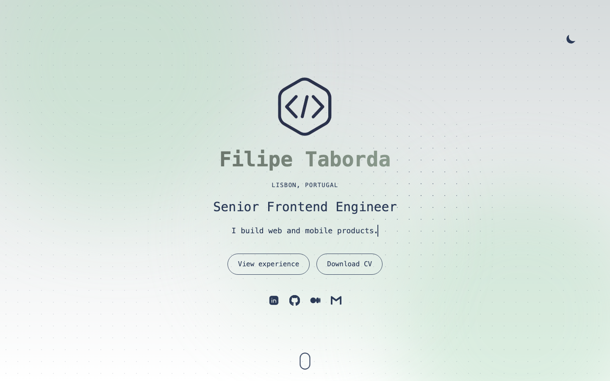

## Personal website - `tabordev`



Live version: [tabordafilipe.pt](https://tabordafilipe.pt)

Personal site and online CV of Filipe Taborda, Senior Frontend Engineer based in Lisbon.

## Features

- Single-page site with About, Skills, Timeline and Contact sections
- Skills with a 5-dot rating (half dots supported)
- Light and dark theme (follows the system preference, can be toggled and is saved in `localStorage`)
- CSS-only animated background (pastel blobs, dot grid and a cursor spotlight)
- Responsive layout with a mobile drawer menu
- Online curriculum at `/curriculum`, with the main skills and their ratings
- Curriculum PDF (A4) generated on demand at `/api/curriculum`

## Used frameworks and libs

- [Next.js](https://nextjs.org) 16 (Pages Router, webpack)
- [React](https://react.dev) 19
- [TypeScript](https://www.typescriptlang.org)
- [Tailwind CSS](https://tailwindcss.com) 3 and [Sass](https://sass-lang.com) modules
- [React PDF](https://react-pdf.org) (`@react-pdf/renderer`) for the curriculum PDF
- [React Vertical Timeline Component](https://github.com/stephane-monnot/react-vertical-timeline)
- [usehooks-ts](https://usehooks-ts.com/)
- [Vercel Analytics](https://vercel.com/docs/analytics)

## Requirements

- Node.js 20.9 or newer (22 recommended) and npm

## How to run locally

From the `tabordev` directory:

```bash
npm install
npm run dev
```

The site is then available at [http://localhost:3000](http://localhost:3000).

| Script          | Description                       |
| --------------- | --------------------------------- |
| `npm run dev`   | Start the development server      |
| `npm run build` | Create the production build       |
| `npm run start` | Serve the production build        |
| `npm run lint`  | Run ESLint                        |

## Editing the content

All the text and data live in JSON files in `src/assets/configs`, so most changes do not need code changes:

| File              | Content                                                       |
| ----------------- | ------------------------------------------------------------- |
| `info.json`       | Name, location, role, tagline, summary and social icons of the main page |
| `sections.json`   | Section ids and names (used by the header menu)               |
| `skills.json`     | Main skills with their rating (0 to 5, halves allowed) and the other skills |
| `timeline.json`   | Work and education timeline                                   |
| `contact-me.json` | Contact section                                               |
| `curriculum.json` | Curriculum page and PDF (experience, education, skill groups) |

Skill icons are in `public/skills` and must match the `name` field in `skills.json` (for example `react` uses `public/skills/react.svg`).

The "Skills" block of the curriculum (page and PDF) shows the main skills from `skills.json` with their dots.

## Project structure

```
src/
  assets/configs/   JSON content (see above)
  components/       UI components (Header, Drawer, Background, Skills, Timeline, ...)
  hooks/            useDarkMode, system theme detection, useIsMobile and visibility helpers
  models/           TypeScript types for the JSON files
  modules/          Page-level modules (Home, Curriculum and CurriculumPDF)
  pages/            Next.js pages (/, /curriculum) and the PDF API route
  styles/           Global styles, colours, themes, mixins and effects
public/             Images, logos and skill/timeline icons
docs/               Screenshot used in this README
```

## Deployment

The site is deployed on [Vercel](https://vercel.com). Vercel must use a supported Node.js version (20.x or newer); set it in the project settings under General, Node.js Version.
